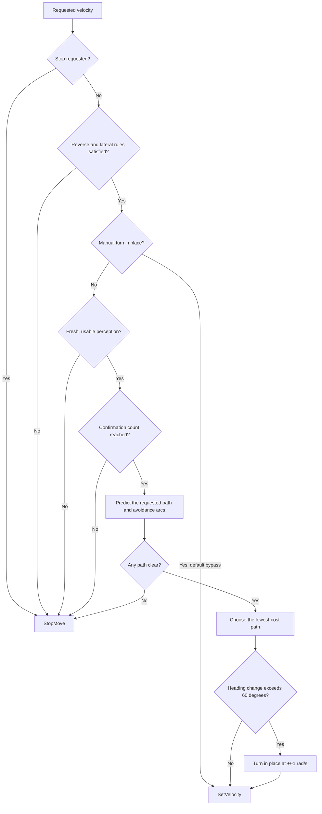

# R1 Vision Safety

This project implments a stereo-vision safety layer for locomotion policies on the Unitree R1. It checks requested velocity commands against nearby obstacles before passing them to the robot, keeping the original command when the predicted path is clear, steering around obstacles where possible, and stopping when no clear path is available.

The safety layer works with local camera observations, allowing a policy to request motion without handling depth processing or collision checking itself. The included keyboard demo shows how these pieces fit
together, using key presses as the source of velocity commands. 

The code is implemented in [`example/r1/vision`](example/r1/vision), which also includes scripts for stereo calibration and depth inspection. The rest of the repository contains the Unitree SDK2 Python package used to communicate with the robot.

## Table of Contents
- [Getting Started](#getting-started)
- [Calibrating the Cameras](#calibrating-the-cameras)
- [Detecting Obstacles (Perception)](#from-camera-images-to-obstacles)
- [Safety Layer & Commands](#how-the-safety-layer-chooses-a-command)
- [Tracking a Target](#tracking-a-target)
- [Changing the Settings](#changing-the-settings)
- [Codebase & File Guide](#a-guide-to-the-code)
- [Future Work](#future-work)

## Getting started

The scripts run on the R1's Jetson backpack, using Jetson's GStreamer plugins to decode the camera streams and TensorRT to run the depth model. The viewers and keyboard demo also need a display for their OpenCV windows.

The runtime dependencies are:

| Dependency | What uses it |
| --- | --- |
| Python 3.8+ | The application and Unitree SDK |
| NumPy and OpenCV | Image processing, calibration and display windows |
| GStreamer with `nvv4l2decoder` and `nvvidconv` | Decoding the camera streams |
| CUDA, PyCUDA and TensorRT | Running LAS2, the wrapper uses TensorRT's 8.5 binding API |
| `cyclonedds==0.10.2` | Sending commands through the Unitree SDK |

The setup below assumes the Jetson's native packages are already installed. The Python package declares NumPy, OpenCV and CycloneDDS as dependencies, while CUDA, TensorRT, PyCUDA and the camera decoder come from the Jetson environment. The [demo setup notes](<documentation/demo_setup.md>) cover instructions to set up the project on the Unitree R1's backpack.

**NOTE**: On the Napping AI Unitree R1, the project is already set up at `~/demo/FollowDemo/unitree_sdk2_python/`. Before running the scripts in this folder, activate the existing virtual environment:

```bash
cd ~/demo/FollowDemo/unitree_sdk2_python/
source .venv/bin/activate

# afterwards, run scripts with `uv run [filename].py`
```

### Depth engine

The repository includes a stereo calibration and a LAS2-S TensorRT engine, with their paths set in [`config.py`](example/r1/vision/config.py). Instructions to install this engine can be found at [`documentation/las2_full`](documentation/las2_full/README.md).


Try out the depth viewer to check that both are working with the camera streams:

```bash
cd example/r1/vision
uv run 3_depth_engine.py
```

The viewer shows the rectified camera image, disparity and depth in metres side by side, and a click on any panel shows the depth at that pixel.  Press **Q** or **Escape** to close the viewer. If the depths shown here look incorrect, [recalibrate the cameras](#calibrating-the-cameras) before relying on those measurements.

### Try the keyboard demo

The keyboard demo connects a simple command source to the safety layer and sends the resulting velocities through the Unitree SDK. This demo can be run from `example/r1/vision`:

```bash
uv run safety_demo_keyboard.py eth10
```

The network interface defaults to `eth10`, with a different name accepted as the
first argument. Key presses are read through the OpenCV window, which needs to
stay focused during operation.

| Key | What happens |
| --- | --- |
| Up arrow | Request forward motion at 0.30 m/s; the safety layer can steer or stop |
| Left / right arrow | Turn in place at +1 / −1 rad/s, bypassing vision checks |
| Down arrow | Request reverse, which is disabled by default |
| Space or M | Stop and reset the safety layer |
| Q or Escape | Exit and call `StopMove()` |

## Calibrating the cameras

Calibration tells the stereo pipeline how the two cameras relate to each other, so it can align their images and convert disparity into metres. A calibration is already included in this repository, but depending on how the disparity map looks, recalibration may be required.

Print the [checkerboard PDF](example/r1/vision/calibration/A4_checkerboard_9x6_inner_25mm.pdf) at actual
size and check that its squares measure 25 mm. The board has 9 $\times$ 6 internal corners. Then, from `example/r1/vision`, run:

```bash
uv run 1_calibrate.py
```

With the whole board visible to both cameras, hold it still for about 1s until a pair is captured automatically, then move or tilt it to a new pose. Spread the captures across the image, including the edges, until the script has collected 30 pairs for fitting and another 8 for validation.

At the end, the script checks that matching corners lie on the same rectified image rows and that reconstructed squares have the right size. A pass requires row RMS (root mean square) $\leq$ 0.5 px, 95th-percentile row error $\leq$ 0.75 px, each validation view's row
RMS $\leq$ 0.75 px, median square-size error $\leq$ 5%, and enough image coverage in the fitting views.

Each result is saved separately from the active calibration, allowing it to be checked in the depth viewer before replacing the existing file. After a passing result and satisfactory depth checks, copy it into place using the folder name from that run:

```bash
cp calibration/capture_YYYYMMDD_HHMMSS/stereo_calibration.npz \
   calibration/stereo_calibration.npz
```

Alternatively, point `CALIBRATION_PATH` in `config.py` at the new file, updating the SGBM viewer's separate `CALIBRATION_FILE` if needed. 

The calibration NPZ stores intrinsics, distortion, stereo and rectification transforms, projection matrices, image dimensions and the baseline in metres.

## From camera images to obstacles

`StereoPerception` turns the left and right camera views into the obstacle points used by the safety layer, combining stereo depth estimation with reliability checks, floor removal and sampling of the nearby scene:


### Pairing the images

`Camera` decodes the UDP H.264 streams and keeps the newest frame from each, recording a sequence number and monotonic arrival timestamp. The live pipeline accepts a changed pair when the arrival times are within 20 ms and the older frame is no more than 0.30 s old.

Since these are decoder-arrival timestamps, a close pair doesn't guarantee that both cameras exposed at the same instant. When a pair is missing, too old or too far apart, perception retains the previous result with its original timestamp, allowing the safety layer to reject it once it becomes stale.

### Turning disparity into depth

The images are rectified using the calibration, then passed to LAS2-S which generates a disparity map. This disparity measures the horizontal shift of a point between the two views. Depth is then calculated as `Z = fx * baseline / disparity`. Before using a pixel, the code checks that its disparity is finite, positive and below the application cutoff, its depth is within 5 m, its corresponding right-image pixel is in bounds, and the two grayscale pixels differ by no more than 45. Rejected pixels get a depth of zero (unknown).

### Keeping the obstacles

During testing, one particular issue was trying to differentiate between the floor and an obstacle. Ideally, this would have been achieved by converting each pixel into world/local coordinates, and checking the height of each reprojected point. However, since the camera intrinsics and extrinsics are not fully reliable, this method is infeasible.

So instead, the code fits a plane to reliable points in the lower part of the image, using camera-height and tilt limits to guide the fit. When it succeeds, only points more than 5 cm above the floor can become obstacles. 

From there, the code keeps points within the local volume: up to 1.5 m ahead, 1.2 m to either side, and within the configured vertical band. These are reduced to one point per 5 cm grid cell for the planner.

### Deciding whether the depth is usable

Before removing the floor, the pipeline measures reliable-depth coverage across the central 60% of image width and 80% of image height. This determines the state sent to the safety layer:

| State | Meaning |
| --- | --- |
| `UNKNOWN` | Fewer than 40% of pixels in that region have reliable depth |
| `OBSTACLE` | Coverage is sufficient and there are local obstacle points |
| `CLEAR` | Coverage is sufficient and there are no local obstacle points |

## How the safety layer chooses a command

For each requested forward velocity, the safety layer checks the predicted motion against the current obstacle points and compares it with curved paths to either side. Among the clear paths, it favours those that are close to the policy's request and have sufficient clearence, returning a stop when none are available.

The interface is `FailClosedVelocityShield.evaluate()`, which takes a
`VelocityCommand`, a `PerceptionSnapshot` and the current monotonic time, then returns a `SafetyDecision` containing the selected command and its reason. 



### Checking the paths

Forward motion planning needs a known perception state and a set of obstacle points. The planner tries the original command plus 24 arcs, adjusting yaw by $\pm$ 0.1 to $\pm$ 1.2 rad/s in 0.1 steps. 

Each path is predicted for 1.5 s in 0.1 s steps, with the robot represented by a 0.28 m radius circle. Paths are rejected wherever this protected radius touches an obstacle point, including at the starting
position, so a single point already inside that radius can block every forward path.

Among the remaining paths, the score favours staying close to the requested speed and yaw rate, rewards extra clearance up to 0.25 m, and adds a small penalty for switching avoidance sides. These can be configured in `safety_layer.py`.

If the chosen path would turn more than 60° over the prediction horizon, the script replaces it with an in-place turn at $\pm$ 1 rad/s.

## Tracking a target (integration with a tracking policy)

The project also includes a demo that integrates the safety layer with a tracking policy. This tracking policy uses YOLO to detects objects in the left-camera image, while BoT-SORT associates detections across frames. The policy follows the first detection matching `TRACKED_LABEL`, currently set to `"stop sign"`, using stereo depth at the bounding-box centre to estimate its distance and bearing.

From `example/r1/vision`, run:

```bash
uv run tracking_demo_augmented.py eth10
```

This also requires the `ultralytics` package and the YOLO weights and tracker configuration referenced by `YOLO_CKPT_PATH` and `YOLO_TRACK_CONF` in `config.py`. Detection runs in a background thread with `imgsz=1280`, which helps the policy track smaller objects that are further away.

### Choosing an action

With valid target depth, the policy requests an in-place turn at $\pm$ 1 rad/s when the target bearing exceeds 30°. Otherwise, it requests forward motion at 0.3 m/s until the estimated target distance is within 0.65 m, where it stops. These requests pass through the safety layer before reaching the locomotion controller.

When safety changes a forward request into an avoidance turn, the demo shifts a virtual target sideways in the image towards that turn. Tracking then follows this augmented target, giving avoidance some influence over subsequent policy requests instead of immediately steering back towards the real target. The offset gradually decays, although further safety corrections can replace it. 

### Recovering a lost target

If a previously detected target disappears, the policy predicts its image position from the last detection, the latest displacement between detections and the remaining augmentation. A small state machine is then used to attempt recovery:

| State | Behaviour |
| --- | --- |
| `FORWARD` | Follow the predicted target for a configured 3 s when its bearing starts within $\pm$ 30° |
| `FIRST_SCAN` | Turn in place towards the predicted target's side of the image for 2 s |
| `SECOND_SCAN` | Turn in place towards the opposite side for another 2 s |
| `FINISHED` | Stop and discard the predicted target until another matching detection appears |

## Changing the settings

Most perception settings are in `config.py`. These are the current defaults:

| Setting | Default | What it controls |
| --- | --- | --- |
| `IMAGE_WIDTH`, `IMAGE_HEIGHT` | 544 × 448 | Decoded camera size and calibration input size |
| `LEFT_PORT`, `RIGHT_PORT` | 5002, 5003 | Camera stream ports |
| `MODEL_WIDTH`, `MODEL_HEIGHT`, `ENGINE_PATH` | 544 × 448, LAS2-S FP16 | Rectified image size and matching engine |
| `MODEL_MAX_DISPARITY` / `MAX_DISPARITY` | 192 / 136 px | Model disparity range / application reliability cutoff |
| `MAX_PAIR_SKEW` / `CAMERA_STALE_TIME` | 0.020 / 0.30 s | Which camera pairs are accepted |
| `MAX_RELIABLE_DEPTH` / `MAX_PHOTOMETRIC_ERROR` | 5 m / 45 | Which depth pixels are accepted |
| `MIN_COVERAGE` | 0.40 | How much reliable depth is needed |
| `GROUND_CAMERA_HEIGHT_RANGE` / `GROUND_MAX_TILT_DEG` | 0.8–1.5 m / 50° | Floor-fitting limits |
| `FLOOR_CLEARENCE` | 0.05 m | Minimum obstacle height above a fitted floor |
| `LOCAL_OBSTACLE_HALF_WIDTH` / `LOCAL_OBSTACLE_MAX_DEPTH` | 1.2 / 1.5 m | How far the local volume extends sideways / forwards |
| `TEST_Y_MIN`, `TEST_Y_MAX`, `TEST_Z_MIN` | −0.1, 1.1, 0.05 m | Camera-Y limits and minimum depth of that volume |
| `LOCAL_POINT_CELL_SIZE` | 0.05 m | Obstacle-point sampling grid |

The footprint, path sampling and scoring settings live in `SafetyConfig` in `safety_layer.py`.

## A guide to the code

These files are all in `example/r1/vision`. The calibration scripts, viewers and demos can be run directly; the remaining files are modules they import.

| File | What it does | How to use it |
| --- | --- | --- |
| `1_calibrate.py` | Collects checkerboard images, fits stereo calibration and checks it against held-out images | `python 1_calibrate.py` |
| `2_depth.py` | Shows depth calculated with OpenCV SGBM | `python 2_depth.py` |
| `3_depth_engine.py` | Shows LAS2 disparity and filtered depth, with click-to-inspect distances | `python 3_depth_engine.py` |
| `safety_demo_keyboard.py` | Reads keys, calls the safety layer, sends motion commands and draws the live display | `python safety_demo_keyboard.py eth10` |
| `tracking.py` | Shows YOLO detections alongside stereo disparity and depth, without sending motion commands | `uv run tracking.py` |
| `tracking_demo.py` | Runs the basic target-following policy through the safety layer | `uv run tracking_demo.py eth10` |
| `tracking_demo_augmented.py` | Adds an augmented target for obstacle avoidance and a recovery state machine for lost detections | `uv run tracking_demo_augmented.py eth10` |
| `tracking_utils.py` | Runs YOLO tracking in a background thread and provides detection, plotting and target-geometry helpers | Import `Tracker`, `TrackingData` and `Box` |
| `safety_perception.py` | Runs the cameras and depth pipeline, returning obstacle points and their timestamp | Import `StereoPerception` |
| `safety_layer.py` | Defines commands, perception states and decisions; predicts paths and chooses a command | Import `FailClosedVelocityShield` and its dataclasses |
| `camera_utils.py` | Starts the GStreamer decoder and keeps the latest timestamped camera frame | Import `Camera` |
| `tensorrt_utils.py` | Prepares model inputs and runs the TensorRT engine | Import `StereoEngine` and `prepare_image` |
| `vision_utils.py` | Provides rectification, depth checks, floor fitting, point projection and drawing helpers | Used by the viewers and perception module |
| `config.py` | Holds paths, dimensions and perception thresholds | Edit for the target setup |

The other useful files are:

| Path, from the repository root | What's there |
| --- | --- |
| `example/r1/vision/calibration/stereo_calibration.npz` | The active stereo calibration |
| `example/r1/vision/calibration/A4_checkerboard_9x6_inner_25mm.pdf` | The printable calibration board |
| `example/r1/vision/calibration/capture_*/` | Saved calibration images, corners, observations and results |
| `engines/lite_any_stereo_v2/` | ONNX models and FP16 engines for both resolutions, plus build logs, timing caches and saved clock settings |
| `documentation/las2_full/`, `documentation/las2_small/` | Model export/build instructions and export Dockerfiles |
| `documentation/calibration_notes.md` | Earlier camera-sync and approximate depth checks |
| `documentation/sync.md` | An rsync example for copying files from the backpack |

## Common issues

**`FLOOR: NO FIT`:** the floor may be out of view, too noisy, or outside the configured camera-height and tilt limits. Since a failed fit keeps reliable points, the floor can then appear as an obstacle.

**`no collision-free local trajectory`:** look at the orange points, especially anything within 0.33 m of the camera origin. Even one point too close can block all forward paths. Points farther away may also leave no room for the sampled arcs.

**Commands appear but the robot barely moves:** through testing, the robot seems to need a speed of at least 0.3 to move reliably, and a turn speed of at least 1 to turn in place.

## Future work

**More robust depth under bright lighting:** Bright lights in the camera view can make disparity extremely noisy, leaving the safety layer with unreliable obstacle measurements. Some ways to improve this could be to do some image preprocessing, or explore alternative depth pipelines that are more robust to these conditions.

**Original camera streams and calibration parameters:** Unitree recently made available the original streams and intrinsic/extrinsic parameters through Unitree's [R1 video service](https://support.unitree.com/home/en/R1_developer/video_service). It would be a good idea to try these out, then compare the results with the current decoded streams and calibration.

**More rigourous testing and validation of parameters and models:** Validate camera intrinsics, stereo alignment, depth maps and obstacle responses against measured references in a controlled environment. Repeated trials would help separate calibration errors, lighting effects and motion-related failures.

**Integration with low-level policies:** Right now the current demos only integrate the safety layer with the existing on-board locomotion policy. It would be useful to see how it would be able to integrate with low-level policies as well.

## Credits and license

This project uses [Unitree SDK2
Python](https://github.com/unitreerobotics/unitree_sdk2_python), [Lite Any
Stereo](https://github.com/TomTomTommi/LiteAnyStereo), OpenCV and NVIDIA's
Jetson/CUDA/TensorRT stack. The repository uses the [BSD 3-Clause
license](LICENSE), while external models and dependencies have their own licenses.