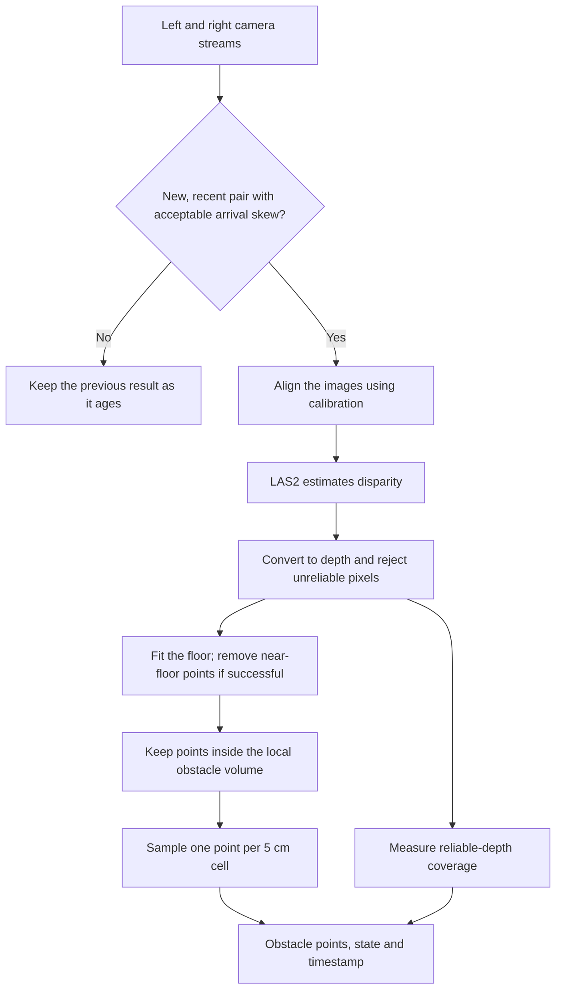
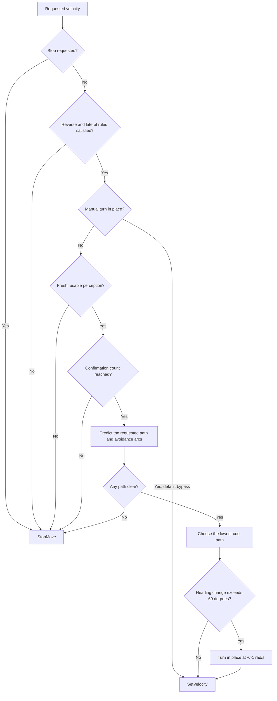

# R1 Vision Safety

This project implments a stereo-vision safety layer for locomotion policies on the Unitree R1. It checks requested velocity commands against nearby obstacles before passing them to the robot, keeping the original command when the predicted path is clear, steering around obstacles where possible, and stopping when no clear path is available.

The safety layer works with local camera observations, allowing a policy to request motion without handling depth processing or collision checking itself. The included keyboard demo shows how these pieces fit
together, using key presses as a simple source of velocity commands.

The code is implemented in [`example/r1/vision`](example/r1/vision), which also includes scripts for stereo calibration and depth inspection. The rest of the repository contains the Unitree SDK2 Python package used to communicate with the robot.

[Getting started](#getting-started) · [Calibration](#calibrating-the-cameras) ·
[Perception](#from-camera-images-to-obstacles) ·
[Safety](#how-the-safety-layer-chooses-a-command) ·
[Settings](#changing-the-settings) · [Files](#a-guide-to-the-code)

## Getting started

The scripts run on the R1's Jetson backpack, using Jetson's GStreamer plugins to decode the camera streams and TensorRT to run the depth model. The viewers and keyboard demo also need a display for their OpenCV windows.

The runtime dependencies are:

| Dependency | What uses it |
| --- | --- |
| Python 3.8+ | The application and Unitree SDK |
| NumPy and OpenCV | Image processing, calibration and display windows |
| GStreamer with `nvv4l2decoder` and `nvvidconv` | Decoding the camera streams |
| CUDA, PyCUDA and TensorRT | Running LAS2, the wrapper uses TensorRT's 8.5 binding API |
| `cyclonedds==0.10.2` | Sending commands through the Unitree SDK |

The setup below assumes the Jetson's native packages are already installed. The Python package declares NumPy, OpenCV and CycloneDDS as dependencies, while CUDA, TensorRT, PyCUDA and the camera decoder come from the Jetson environment. The [backpack setup notes](<documentation/unitree_sdk2_python installation.md>) also cover working in an environment without a usable pip.

```bash
git clone https://github.com/NAPPING-AI/robot-vision-safety.git
cd robot-vision-safety

# Optional: create a venv that can use the Jetson's existing Python packages.
python3 -m venv --system-site-packages .venv
source .venv/bin/activate

# Check that the dependencies are available, then install the SDK package.
python -c "import numpy, cv2, cyclonedds, pycuda.driver, tensorrt"
python -m pip install --no-deps -e .
```

### Start with the depth viewer

The repository includes a stereo calibration and a LAS2-S TensorRT engine, with
their paths set in [`config.py`](example/r1/vision/config.py). Start with the
depth viewer to check that both are working with the camera streams:

```bash
cd example/r1/vision
python 3_depth_engine.py
```

The viewer shows the rectified camera image, disparity and depth in metres side
by side, with a click on any panel showing the depth at that pixel. Black depth
pixels indicate unknown measurements, so they can't be treated as clear space.
Press **Q** or **Escape** to close the viewer.

Nearby objects should appear at sensible distances; if the camera geometry has
changed, [recalibrate the cameras](#calibrating-the-cameras) before relying on
those measurements.

An OpenCV SGBM viewer provides a CPU stereo method for comparison. It doesn't
need TensorRT or PyCUDA:

```bash
python 2_depth.py
```

This shows the rectified image beside a depth view coloured over 0.3–3 m. The
driving demo uses LAS2, so changes to the SGBM matcher won't affect avoidance.
Run these scripts from `example/r1/vision`, and close one before starting
another: they listen on the same camera ports.

### If the engine won't load

TensorRT engines depend on the GPU and runtime they were built for, so the
included engine may need rebuilding on the target Jetson. The ONNX file is
included for this purpose; run the following from the repository root:

```bash
/usr/src/tensorrt/bin/trtexec \
  --onnx=engines/lite_any_stereo_v2/las2_s_r1_448x544_d192_opset16.onnx \
  --saveEngine=engines/lite_any_stereo_v2/las2_s_r1_448x544_d192_opset16_fp16.engine \
  --fp16 --memPoolSize=workspace:2048 --buildOnly
```

The [full-resolution](documentation/las2_full/README.md) and
[smaller-engine](documentation/las2_small/README.md) notes explain how to export
the ONNX files. Use `config.py` for the current runtime settings; some older
build notes use a different disparity cutoff.

### Try the keyboard demo

The keyboard demo connects a simple command source to the safety layer and sends
the resulting velocities through the Unitree SDK. Once the depth looks
reasonable and the robot is ready for high-level locomotion, close the viewer
and run the demo from `example/r1/vision`:

```bash
python safety_demo_keyboard.py eth10
```

The network interface defaults to `eth10`, with a different name accepted as the
first argument. Key presses are read through the OpenCV window, which needs to
stay focused during operation.

| Key | What happens |
| --- | --- |
| Up arrow | Request forward motion at 0.30 m/s; the safety layer can steer or stop |
| Left / right arrow | Turn in place at +1 / −1 rad/s, bypassing vision checks |
| Down arrow | Request reverse, which is disabled by default |
| Space or M | Stop and reset the safety layer |
| Q or Escape | Exit and call `StopMove()` |

Movement continues while arrow-key events are being received, with a stop
requested after 0.25 s without another event. Since this timeout is checked in
the main processing loop, the actual stopping response also depends on inference
time, RPC delays and the robot itself; an independent stop should remain
available during testing.

The display combines orange obstacle highlights and a floor wireframe with
depth, frame age, camera-pair skew and reliable-depth coverage, alongside the
reason for the latest safety decision.

In the terminal, `delta` reports the adjustment to the requested yaw rate, so it
may differ from the final yaw rate sent to the robot. The demo accepts motion
return codes `0` and `127`, but doesn't measure whether the robot actually
achieved the requested speed. While moving, it refreshes an unchanged command
every 0.40 s with a 1 s command duration; the RPC timeout is 5 s.

## Calibrating the cameras

Calibration tells the stereo pipeline how the two cameras relate to each other,
so it can align their images and convert disparity into metres. A calibration is
included; changes to the camera geometry require a new one.

Print the [checkerboard
PDF](example/r1/vision/calibration/A4_checkerboard_9x6_inner_25mm.pdf) at actual
size and check that its squares measure 25 mm. The board has 9 × 6 internal
corners. Then, from `example/r1/vision`, run:

```bash
python 1_calibrate.py
```

With the whole board visible to both cameras, hold it still for about 1.2 s
until a pair is captured automatically, then move or tilt it to a new pose.
Spread the captures across the image, including the edges, until the script has
collected 30 pairs for fitting and another 8 for validation.

Each run gets its own `calibration/capture_YYYYMMDD_HHMMSS/` folder containing
the images, detected corners, combined observations and resulting calibration.
Q/Escape cancels capture; images already saved will remain there.

At the end, the script checks that matching corners lie on the same rectified
image rows and that reconstructed squares have the right size. A pass requires
row RMS ≤0.5 px, 95th-percentile row error ≤0.75 px, each validation view's row
RMS ≤0.75 px, median square-size error ≤5%, and enough image coverage in the
fitting views.

Each result is saved separately from the active calibration, allowing it to be
checked in the depth viewer before replacing the existing file. After a passing
result and satisfactory depth checks, copy it into place using the folder name
from that run:

```bash
cp calibration/capture_YYYYMMDD_HHMMSS/stereo_calibration.npz \
   calibration/stereo_calibration.npz
```

Alternatively, point `CALIBRATION_PATH` in `config.py` at the new file, updating
the SGBM viewer's separate `CALIBRATION_FILE` if needed. The loader checks image
dimensions but doesn't enforce the saved `validation_passed` flag, so a failed
calibration must be excluded manually.

The calibration NPZ stores intrinsics, distortion, stereo and rectification
transforms, projection matrices, image dimensions and the baseline in metres.

## From camera images to obstacles

`StereoPerception` turns the left and right camera views into the obstacle
points used by the safety layer, combining stereo depth estimation with
reliability checks, floor removal and sampling of the nearby scene:



### Pairing the images

`Camera` decodes the UDP H.264 streams and keeps the newest frame from each,
recording a sequence number and monotonic arrival timestamp. The live pipeline
accepts a changed pair when the arrival times are within 20 ms and the older
frame is no more than 0.30 s old.

These are decoder-arrival timestamps, so a close pair doesn't guarantee that
both cameras exposed at the same instant. When a pair is missing, too old or too
far apart, perception retains the previous result with its original timestamp,
allowing the safety layer to reject it once it becomes stale.

### Turning disparity into depth

The images are rectified using the calibration, then passed to LAS2-S through
TensorRT. `prepare_image()` converts BGR images into RGB float32 `NCHW` tensors,
keeping pixel values in the 0–255 range. The engine uses bindings named `left`,
`right` and `disparity`.

Disparity measures the horizontal shift of a point between the two views. Depth
is calculated as `Z = fx × baseline / disparity`. Before using a pixel, the code
checks that its disparity is finite, positive and below the application cutoff,
its depth is within 5 m, its corresponding right-image pixel is in bounds, and
the two grayscale pixels differ by no more than 45. Rejected pixels get a depth
of zero.

### Keeping the obstacles

The next step is to avoid treating the floor as an obstacle. The code fits a
plane to reliable points in the lower part of the image, using camera-height and
tilt limits to guide the fit. When it succeeds, only points more than 5 cm above
the floor can become obstacles. **If it fails, reliable points are kept**; the
failure doesn't automatically make perception `UNKNOWN`.

From there, the code keeps points within the local volume: up to 1.5 m ahead,
1.2 m to either side, and within the configured vertical band. These are reduced
to one point per 5 cm grid cell for the planner, without requiring points to
belong to a larger connected obstacle patch.

In camera coordinates, X points right, Y down and Z forward: `X = (u − cx)Z/fx`,
`Y = (v − cy)Z/fy`. The planner uses `(forward, left) = (Z, −X)`. It treats
these as robot-relative coordinates; there isn't a calibrated camera-to-body
transform.

### Deciding whether the depth is usable

Before removing the floor, the pipeline measures reliable-depth coverage across
the central 60% of image width and 80% of image height. This determines the
state sent to the safety layer:

| State | Meaning |
| --- | --- |
| `UNKNOWN` | Fewer than 40% of pixels in that region have reliable depth |
| `OBSTACLE` | Coverage is sufficient and there are local obstacle points |
| `CLEAR` | Coverage is sufficient and there are no local obstacle points |

`CLEAR` appears on screen as `NO OBSTACLE DETECTED`. It describes the available
measurements; some parts of the image can still have unknown depth. Each result
uses the earlier camera-arrival timestamp, and the driving demo checks its age
again after inference.

## How the safety layer chooses a command

For each requested forward velocity, the safety layer checks the predicted
motion against the current obstacle points and compares it with curved paths to
either side. Among the clear paths, it favours the one closest to the policy's
request, returning a stop when none are available.

The interface is `FailClosedVelocityShield.evaluate()`, which takes a
`VelocityCommand`, a `PerceptionSnapshot` and the current monotonic time, then
returns a `SafetyDecision` containing the selected command and its reason. The
keyboard demo supplies these inputs and forwards the result to the robot;
another policy can use the same interface to submit velocity requests.



### Checking the paths

Forward motion needs a known perception state, valid finite `N × 2` obstacle
points and a measurement no older than 0.55 s. An `OBSTACLE` state is expected
during avoidance: the point positions determine whether there's room to move.
The default confirmation count is one; raising it counts eligible evaluations,
which may reuse the same camera result.

The planner tries the original command plus 24 arcs, adjusting yaw by ±0.1 to
±1.2 rad/s in 0.1 steps. The arcs use 75% of the requested forward speed, so a
0.30 m/s request becomes 0.225 m/s during avoidance.

Each path is predicted for 1.5 s in 0.1 s steps, with the robot represented by a
0.28 m radius circle plus a 0.05 m margin. Paths are rejected wherever this 0.33
m protected radius touches an obstacle point, including at the starting
position, so a single point already inside that radius can block every forward
path.

Among the remaining paths, the score favours staying close to the requested
speed and yaw rate, rewards extra clearance up to 0.25 m, and adds a small
penalty for switching avoidance sides. The turn and clearance weights are 0.20
and 0.04, with a side-change penalty of 0.001.

If the chosen path would turn more than 60° over the prediction horizon, the
script replaces it with an in-place turn at ±1 rad/s. That replacement isn't
simulated separately, and the logged clearance still belongs to the original
arc. There's no settling pause before the next decision.

`MotionController` sends the selected velocity through
`LocoClient.SetVelocity()`, leaving the R1's onboard locomotion policy to
execute the motion.

### In-place turns

Manual left/right turns take an early return and bypass perception checks by
default. The keyboard script's startup message says they require fresh vision
and clearance, but that message doesn't match the implementation.

Setting `allow_turn_in_place=False` removes the early bypass and the automatic
sharp-turn conversion. A manual pivot then goes through perception validation,
but still returns without a clearance calculation. The flag therefore doesn't
fully disable in-place turns.

## Changing the settings

Most perception settings are in `config.py`. These are the current defaults:

| Setting | Default | What it controls |
| --- | --- | --- |
| `IMAGE_WIDTH`, `IMAGE_HEIGHT` | 544 × 448 | Decoded camera size and calibration input size |
| `LEFT_PORT`, `RIGHT_PORT` | 5002, 5003 | Camera stream ports |
| `MODEL_WIDTH`, `MODEL_HEIGHT`, `ENGINE_PATH` | 544 × 448, LAS2-S FP16 | Rectified image size and matching engine |
| `MODEL_MAX_DISPARITY` / `MAX_DISPARITY` | 192 / 136 px | Model disparity range / application reliability cutoff |
| `MAX_PAIR_SKEW` / `CAMERA_STALE_TIME` | 0.020 / 0.30 s | Which camera pairs are accepted |
| `MAX_RELIABLE_DEPTH` / `MAX_PHOTOMETRIC_ERROR` | 5 m / 45 | Which depth pixels are accepted |
| `MIN_COVERAGE` | 0.40 | How much reliable depth is needed |
| `GROUND_CAMERA_HEIGHT_RANGE` / `GROUND_MAX_TILT_DEG` | 0.8–1.5 m / 50° | Floor-fitting limits |
| `FLOOR_CLEARENCE` | 0.05 m | Minimum obstacle height above a fitted floor |
| `LOCAL_OBSTACLE_HALF_WIDTH` / `LOCAL_OBSTACLE_MAX_DEPTH` | 1.2 / 1.5 m | How far the local volume extends sideways / forwards |
| `TEST_Y_MIN`, `TEST_Y_MAX`, `TEST_Z_MIN` | −0.1, 1.1, 0.05 m | Camera-Y limits and minimum depth of that volume |
| `LOCAL_POINT_CELL_SIZE` | 0.05 m | Obstacle-point sampling grid |

The footprint, path sampling and scoring settings live in `SafetyConfig` in
`safety_layer.py`. Keyboard speeds and control timings are near the top of
`safety_demo_keyboard.py`.

To use the smaller engine, set the model size to 384 × 320, select the `320x384`
engine and use the 96 px application disparity cutoff shown in the commented
configuration. Leave the decoded camera dimensions unchanged; rectification
scales the output projection. Both engines use a model disparity range of 192
px.

A few settings belong to an older close-obstacle helper: `TEST_HALF_WIDTH` and
`TEST_Z_MAX` don't control the active planner's extent. Likewise,
`MIN_OBSTACLE_PIXELS` helps floor fitting and the older helper, but doesn't
filter small connected patches out of the planner's points.

## A guide to the code

These files are all in `example/r1/vision`. The first four can be run directly;
the others are modules they import.

| File | What it does | How to use it |
| --- | --- | --- |
| `1_calibrate.py` | Collects checkerboard images, fits stereo calibration and checks it against held-out images | `python 1_calibrate.py` |
| `2_depth.py` | Shows depth calculated with OpenCV SGBM | `python 2_depth.py` |
| `3_depth_engine.py` | Shows LAS2 disparity and filtered depth, with click-to-inspect distances | `python 3_depth_engine.py` |
| `safety_demo_keyboard.py` | Reads keys, calls the safety layer, sends motion commands and draws the live display | `python safety_demo_keyboard.py eth10` |
| `safety_perception.py` | Runs the cameras and depth pipeline, returning obstacle points and their timestamp | Import `StereoPerception` |
| `safety_layer.py` | Defines commands, perception states and decisions; predicts paths and chooses a command | Import `FailClosedVelocityShield` and its dataclasses |
| `camera_utils.py` | Starts the GStreamer decoder and keeps the latest timestamped camera frame | Import `Camera` |
| `tensorrt_utils.py` | Prepares model inputs and runs the TensorRT engine | Import `StereoEngine` and `prepare_image` |
| `vision_utils.py` | Provides rectification, depth checks, floor fitting, point projection and drawing helpers | Used by the viewers and perception module |
| `config.py` | Holds paths, dimensions and perception thresholds | Edit for the target setup |

`vision_utils.py` also contains `detect_obstacles()`, an older helper that
groups nearby pixels into connected patches. The live demo doesn't call it;
avoidance uses the local points described above.

The other useful files are:

| Path, from the repository root | What's there |
| --- | --- |
| `example/r1/vision/calibration/stereo_calibration.npz` | The active stereo calibration |
| `example/r1/vision/calibration/head_camera_calibration.npz` | Another calibration archive, unused by these scripts |
| `example/r1/vision/calibration/A4_checkerboard_9x6_inner_25mm.pdf` | The printable calibration board |
| `example/r1/vision/calibration/capture_*/` | Saved calibration images, corners, observations and results |
| `engines/lite_any_stereo_v2/` | ONNX models and FP16 engines for both resolutions, plus build logs, timing caches and saved clock settings |
| `documentation/las2_full/`, `documentation/las2_small/` | Model export/build instructions and export Dockerfiles |
| `documentation/calibration_notes.md` | Earlier camera-sync and approximate depth checks |
| `documentation/sync.md` | An rsync example for copying files from the backpack |

## When something doesn't look right

**No camera images:** check the UDP stream routing and ports, then check that
`gst-launch-1.0`, `nvv4l2decoder` and `nvvidconv` are available. Close any other
viewer or demo using those streams. If images arrive but pairs aren't accepted,
look at arrival skew, frame age and inference time.

**Mostly black depth or `UNKNOWN`:** check calibration, lighting and scene
texture first. Stereo timing, the disparity cutoff and the photometric threshold
also affect how many pixels survive. A calibration size error means the decoded
image dimensions don't match those recorded in the calibration.

**`FLOOR: NO FIT`:** the floor may be out of view, too noisy, or outside the
configured camera-height and tilt limits. Since a failed fit keeps reliable
points, the floor can then appear as an obstacle.

**`no collision-free local trajectory`:** look at the orange points, especially
anything within 0.33 m of the camera origin. Even one false point there can
block all forward paths. Points farther away may also leave no room for the
sampled arcs.

**Commands appear but the robot barely moves:** avoidance asks for 0.225 m/s by
default. Check what the onboard policy can execute before adjusting that speed.
If keys do nothing, check window focus, key repeat, the network interface and
whether the robot is ready for locomotion. The displayed safety reason helps
distinguish a blocked request from a control issue.

## Current limits

Avoidance only uses the current camera observations. There's no obstacle memory,
and sufficient overall depth coverage doesn't guarantee that every obstacle has
a valid measurement. An object can lose depth while the rest of the image still
passes the coverage check.

The path prediction also assumes the robot follows each velocity command
immediately. It uses a circular footprint at the camera origin, without
modelling braking distance, command delay, camera-to-body offset, body sway or
actual measured velocity. Check those assumptions against the physical robot
when choosing the footprint and speeds.

The calibration checks and engine-build logs cover individual parts of the
system. They don't validate collision avoidance as a whole, and this revision
has no committed automated test suite.

## Credits and license

This project uses [Unitree SDK2
Python](https://github.com/unitreerobotics/unitree_sdk2_python), [Lite Any
Stereo](https://github.com/TomTomTommi/LiteAnyStereo), OpenCV and NVIDIA's
Jetson/CUDA/TensorRT stack. The repository uses the [BSD 3-Clause
license](LICENSE), while external models and dependencies have their own licenses.